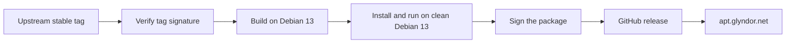

# podman-deb

Signed Podman packages for Debian 13, built from the latest stable upstream release.

[](https://github.com/Glyndor/podman-deb/actions/workflows/release.yml)

Debian 13 ships Podman 5.4. This repository packages the newest stable Podman as a `.deb` for `amd64` and `arm64`, so a Debian 13 host can run the current release and receive its fixes through `apt`.

## Install

The package is served from the Glyndor apt repository. See [apt.glyndor.net](https://apt.glyndor.net) for setup, then:

```bash
sudo apt install podman
```

Because the Glyndor version is newer than Debian's, `apt` prefers it once the repository is configured.

## How a release is made



- A scheduled workflow looks for the newest stable `containers/podman` tag every six hours. Pre-releases are ignored.
- The tag must be an annotated tag signed by a key listed in [containers/release-keys](https://github.com/containers/release-keys); the keys are kept in `keyring/podman/`. An unsigned, expired or unknown signature stops the run.
- The package is built from the official sources with the upstream `make` targets.
- Before signing, the package is installed on a clean Debian 13 and runs a container.
- If any step fails nothing is published, and the previous release remains the latest.

Each release carries one `.deb` and one detached `.sig` per architecture. Verification instructions are in [docs/verify.md](docs/verify.md).

## Scope

This repository only packages Podman. Dependencies such as `conmon`, `crun` and `netavark` come from Debian. Report Podman bugs to [containers/podman](https://github.com/containers/podman).

## License

[MIT](LICENSE) for the packaging scripts. Podman is licensed under Apache-2.0 by its authors.
