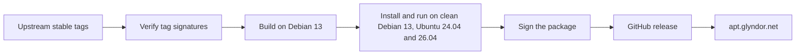

# podman

Signed Podman packages for Debian 13 and Ubuntu 24.04 and 26.04, built from the latest stable upstream releases.

[](https://github.com/Glyndor/podman/actions/workflows/release.yml)

Debian 13 ships Podman 5.4 with netavark 1.14, which is too old for current Podman. This repository packages the newest stable Podman together with the netavark and aardvark-dns it needs as one `.deb` for `amd64` and `arm64`, so a Debian 13 or Ubuntu 24.04 or 26.04 host can run the current release and receive its fixes through `apt`.

## Install

```bash
curl -fsSL https://apt.glyndor.net/install/podman | sudo sh
```

It adds the Glyndor apt repository, installs its signing key after checking the fingerprint, and installs the package. From then on `apt` keeps it current: the Glyndor version is newer than the distribution's, so `apt` prefers it. What the script does, step by step, is described at [apt.glyndor.net](https://apt.glyndor.net).

## How a release is made



- A scheduled workflow looks for the newest stable tag of `containers/podman`, `containers/netavark` and `containers/aardvark-dns` every six hours. Pre-releases are ignored. A new tag of any of the three starts a release.
- Each tag must be an annotated tag signed by a key listed in [containers/release-keys](https://github.com/containers/release-keys); the keys are kept in `keyring/podman/`. An unsigned, expired or unknown signature stops the run.
- The package is built from the official sources with the upstream `make` targets. Rust comes from Debian's own `trixie-backports`.
- Before signing, the same package is installed on clean Debian 13, Ubuntu 24.04 and Ubuntu 26.04, and runs a container on each, including one on a bridge network.
- It links only libc, libgcc and libseccomp, so one package serves every release. Signature checks use Go's OpenPGP instead of gpgme, and subid and sqlite are not linked, because those libraries are renamed between releases. Debian 12 is not supported: its glibc is older than netavark needs.
- On Ubuntu 24.04 the package uses `runc`, because that release's `crun` is too old for current Podman.
- Last, the package replaces Podman on the build runner itself, an Ubuntu virtual machine, and runs a rootless container on `pasta`, which the containers above cannot do.
- If any step fails nothing is published, and the previous release remains the latest. A failed scheduled run also opens an issue in this repository.

Each release carries one `.deb` and one detached `.sig` per architecture, and a build provenance attestation. A second, post-quantum (ML-DSA-65) signature can sit beside the Ed25519 one. The second signature is not required yet. [docs/verify.md](docs/verify.md) shows how to check the signature with OpenSSL and the attestation with `gh`.

## Scope

The package replaces Debian's `netavark` and `aardvark-dns`. It also ships `passt` and `pasta`, built from Debian's signed source of a release newer than the one Podman 6.2.0 asks for, and the containers-common configuration of the release. Other dependencies such as `conmon` and `crun` come from Debian. Release versions follow Podman's (`6.2.0`), with a `+rN` suffix when netavark, aardvark-dns or the way the package is built (everything under `scripts/build/`) changes under the same Podman. A packaging fix is the most common reason for one. Report Podman bugs to [containers/podman](https://github.com/containers/podman).

## License

[MIT](LICENSE) for the packaging scripts. Podman is licensed under Apache-2.0 by its authors.
