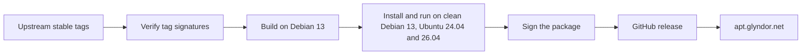

# podman

Signed Podman packages for Debian 13 and Ubuntu 24.04 and 26.04, built from the latest stable upstream releases.

[](https://github.com/Glyndor/podman/actions/workflows/release.yml)

Debian and Ubuntu ship an older Podman and netavark than current Podman needs. This repository packages the newest stable Podman together with the netavark and aardvark-dns it needs as one `.deb` for `amd64` and `arm64`, so a Debian 13 or Ubuntu 24.04 or 26.04 host can run the current release and receive its fixes through `apt`.

## Install

```bash
curl -fsSL https://apt.glyndor.net/install/podman | sudo sh
```

The script needs `curl` and `ca-certificates`. A minimal image, a container for
example, has neither and has no `sudo` either. There you are already root, so
install the two and run the command above without `sudo`:

```bash
apt-get update && apt-get install -y ca-certificates curl
```

It adds the Glyndor apt repository, installs its signing key after checking the fingerprint, and installs the package. From then on `apt` keeps it current: the Glyndor version is newer than the distribution's, so `apt` prefers it. The [apt repository README](https://github.com/Glyndor/apt#install) describes what the script does, step by step.

If the distribution's Podman is already installed, the package replaces it, along with the distribution's `netavark`, `aardvark-dns`, `passt` and `golang-github-containers-common`: apt removes those packages. Debian 12 and Ubuntu 22.04 are refused, because their glibc is older than the package needs; the [apt repository README](https://github.com/Glyndor/apt#supported-releases) lists the releases that were measured.

Once it is installed, use `podman` as usual, or add [podup](https://github.com/Glyndor/podup) to run Compose projects on it.

## Verify a package

`apt` verifies the archive signature by itself. To check a package you downloaded, each release carries one `.deb` and one detached `.sig` per architecture, made with the Glyndor Ed25519 release key, and a build provenance attestation. [docs/verify.md](docs/verify.md) shows how to check the signature with OpenSSL and the attestation with `gh`.

A second, post-quantum release signature (ML-DSA-65) is supported beside the Ed25519 one and never replaces it. The second signature is not required yet.

## What differs from the distribution's Podman

- Podman, netavark and aardvark-dns are the newest stable upstream releases. netavark filters with nftables and has no iptables driver.
- The package also ships `passt` and `pasta`, and the containers-common configuration of the release.
- On Ubuntu 24.04 the package uses `runc`, because that release's `crun` is too old for current Podman.
- Versions follow Podman's, with a `+rN` suffix when the packaging changes under the same Podman. [docs/release-process.md](docs/release-process.md) explains the numbering.

## Known cases

- A `containers.conf` that names the `iptables` firewall driver stops every container on a bridge network with `netavark: Must provide a valid firewall backend, got iptables`. Remove the line or name `nftables`.
- On Ubuntu 24.04 and 26.04 the package adds one signal rule to the AppArmor profile of `pasta`. Without it, stopping the last container of a rootless bridge network fails with `500 rootless netns: kill network process: permission denied`.

[docs/known-cases.md](docs/known-cases.md) has the detail of both.

## How a release is made



A scheduled workflow checks every six hours for a new stable tag of Podman, netavark or aardvark-dns, and a tag must carry a signature from a known upstream key. The package is installed and run on clean Debian 13, Ubuntu 24.04 and 26.04 before it is signed. If any step fails nothing is published, and the previous release remains the latest. [docs/release-process.md](docs/release-process.md) lists every step.

---

See [CONTRIBUTING.md](CONTRIBUTING.md). Report Podman bugs to [Podman](https://github.com/podman-container-tools/podman).

## License

[MIT](LICENSE) for the packaging scripts. Podman is licensed under Apache-2.0 by its authors.
